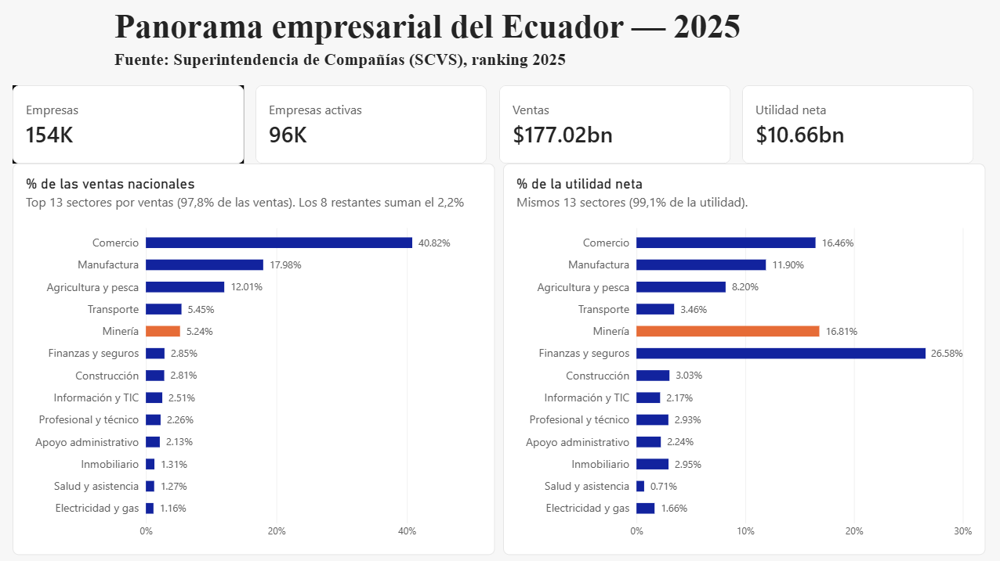
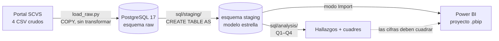
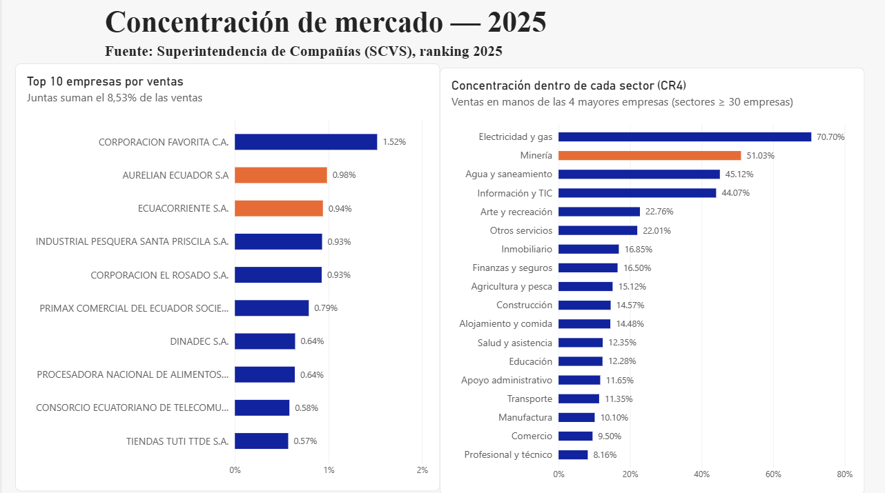
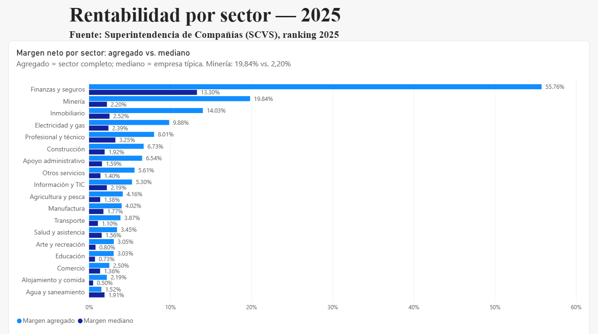
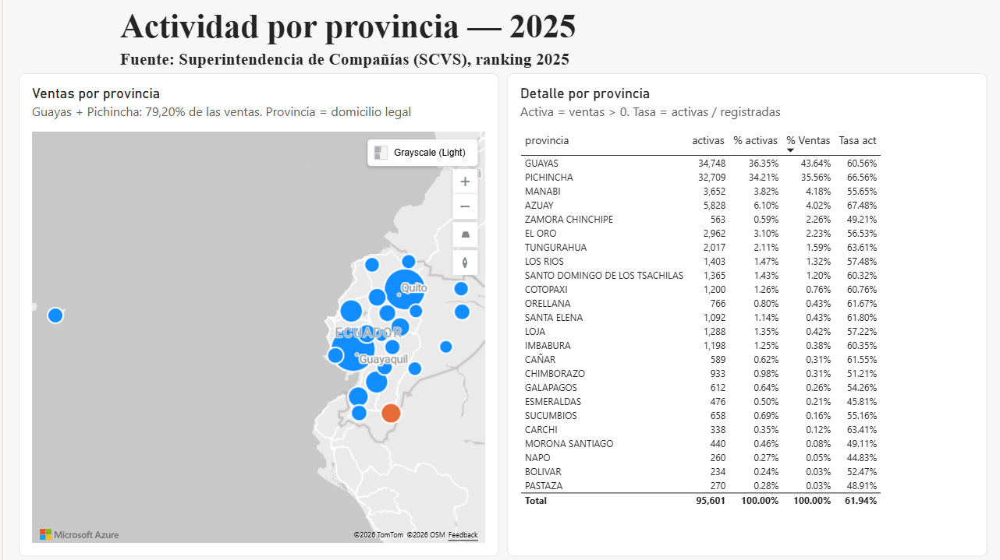

# Panorama empresarial del Ecuador 2025 — SQL + Power BI

[English](README.md) | **Español**

Análisis de punta a punta de los estados financieros de **154.343 compañías ecuatorianas** (ejercicio 2025), con los datos públicos de la Superintendencia de Compañías, Valores y Seguros (SCVS). Los CSV crudos se cargan a PostgreSQL, se limpian con SQL, se analizan en cuatro preguntas de negocio y se presentan en un dashboard de Power BI de 4 páginas. Cada cifra del dashboard está cuadrada contra el SQL.



---

## Preguntas de negocio

| # | Pregunta | Respuesta principal |
|---|---|---|
| Q1 | ¿Qué sectores concentran las ventas y la utilidad? | Comercio tiene el **40,82%** de las ventas, pero Finanzas y Minería se llevan el **43,4%** de la utilidad neta con solo ~8% de las ventas. |
| Q2 | ¿Qué tan concentrado está el mercado? | A nivel nacional no lo está (top-10 = **8,53%** de las ventas), pero dentro de los sectores sí: CR4 de Electricidad y gas = **70,70%**, Minería **51,03%**. |
| Q3 | ¿Qué sectores son más rentables? | Depende de la métrica: el margen agregado supera al mediano en **17 de 18** sectores. Minería: **19,84%** vs **2,20%**. |
| Q4 | ¿Dónde está la actividad empresarial? | Guayas + Pichincha concentran el **70,56%** de las empresas activas y el **79,20%** de las ventas. Zamora Chinchipe es 5.ª en ventas por dos mineras. |

**Hilo conductor: la minería.** Aparece en las cuatro preguntas: 2 de las 3 empresas más grandes del país, el segundo sector más concentrado, la mayor brecha entre las empresas grandes y la típica, y la razón por la que una provincia amazónica pequeña es 5.ª en ventas.

---

## Arquitectura



- **Enfoque ELT:** Python solo carga los CSV crudos a Postgres; toda la transformación se hace en SQL.
- **Capa raw (`raw`):** 4 tablas cargadas tal cual vienen (todo como `text`), con verificación de filas contra cada CSV.
- **Capa staging (`staging`):** tablas tipadas y limpias que forman un modelo estrella:
  - `ranking_2025` (hechos, 1 fila por empresa)
  - `compania` (nombre, provincia)
  - `ciiu_seccion` (21 sectores con etiquetas cortas)
  - `segmento` (tamaño de la empresa)
- **Capa de análisis (`sql/analysis/`):** un archivo por pregunta, con cuadres y chequeos de integridad de los joins.
- **Dashboard:** Power BI conectado a `staging` (modelo estrella, 3 relaciones `*:1` de dirección única, 11 medidas DAX), guardado como **Power BI Project (`.pbip`)** para que el modelo y el DAX se puedan leer como texto en este repo.

### Stack

PostgreSQL 17 (Docker en WSL2) · Python 3 (`psycopg` 3, `python-dotenv`) · SQL · Power BI Desktop (`.pbip` / TMDL) · Git · `ruff`

---

## Dashboard

| Página | Pregunta | Contenido |
|---|---|---|
| 1. Panorama | Q1 | 4 KPI + % de ventas vs % de utilidad por sector |
| 2. Concentración | Q2 | Top-10 nacional + CR4 por sector |
| 3. Rentabilidad | Q3 | Margen neto agregado vs mediano por sector |
| 4. Territorio | Q4 | Mapa de ventas + tabla por provincia |

La minería va resaltada en **naranja** en todas las páginas.

<details>
<summary>Ver páginas 2–4</summary>





</details>

---

## Hallazgos

### Q1: las ventas y la utilidad no van de la mano
- Comercio tiene el **40,82%** de las ventas; los 3 primeros sectores (Comercio, Manufactura, Agricultura y pesca) suman **~70,8%**.
- Finanzas (**2,85%** de las ventas) y Minería (**5,24%**) se llevan juntas **~43,4%** de la utilidad neta.

### Q2: un país poco concentrado con sectores concentrados
- Las 10 empresas más grandes suman solo el **8,53%** de las ventas nacionales. La mayor, Corporación Favorita, tiene el **1,52%**.
- La concentración está dentro de los sectores (CR4 = % de las ventas del sector en manos de sus 4 mayores empresas, sectores con ≥ 30 empresas activas):
  - Electricidad y gas: **70,70%**
  - Minería: **51,03%**
  - Agua y saneamiento: **45,12%**
  - Información y TIC: **44,07%**
- **Paradoja:** Comercio pone 5 empresas en el top-10 nacional, pero tiene uno de los CR4 más bajos (**9,50%**). Es un sector enorme y fragmentado.

### Q3: las empresas grandes ganan más que la típica
- Solo **95.601 de 154.343** empresas (**61,94%**) reportaron ventas > 0.
- El margen agregado (utilidad total del sector ÷ ventas totales del sector) supera al mediano (empresa típica) en **17 de 18** sectores.
- Minería: **19,84%** agregado vs **2,20%** mediano (~9 veces).
- Finanzas lidera en ambas métricas (**55,76% / 13,30%**). Su agregado probablemente está inflado por holdings, que V1 no identifica.
- Fuera de Finanzas, los márgenes medianos van del **0,50% al 3,25%**.
- Agua y saneamiento es el único sector donde el mediano supera al agregado.

### Q4: la actividad se concentra en dos provincias
- Guayas + Pichincha concentran el **70,56%** de las empresas activas y el **79,20%** de las ventas.
- Zamora Chinchipe es **5.ª** en ventas (**2,26%**) con solo el **0,59%** de las empresas activas. Aurelian (43,55%) y Ecuacorriente (41,62%) generan el **85,17%** de sus ventas.
- La tasa de actividad (activas ÷ registradas) va del **44,83%** (Napo) al **67,48%** (Azuay). La Amazonía y Esmeraldas tienen las tasas más bajas.

---

## Recomendaciones

1. **Reportar la rentabilidad con dos métricas.** El margen agregado describe al sector; el mediano, a la empresa típica. Usar solo el agregado sobrestima la rentabilidad que obtiene la mayoría de las empresas (Minería: 19,84% vs 2,20%).
2. **Medir la concentración por sector o subsector, nunca a nivel nacional.** El top-10 nacional sugiere una economía competitiva, mientras que 4 sectores tienen CR4 > 44%. Para afirmar algo sobre un mercado específico (por ejemplo, supermercados) hay que bajar a `ciiu_n6`: la sección G del CIIU es demasiado amplia.
3. **No leer el mapa territorial como el lugar de operación.** La provincia es el domicilio legal de la empresa. Un análisis regional debería cruzar estos datos con información sobre dónde operan realmente las empresas.
4. **Tratar los conteos de empresas con cuidado.** El 38% de las empresas del ranking no reporta ventas. Antes de usar esos conteos como "empresas activas", conviene filtrar por ventas o por estado de los estados financieros.

**Hipótesis no probadas en V1** (se presentan como hipótesis, no como conclusiones): la brecha de margen en Minería y Electricidad es coherente con sectores intensivos en capital; las tarifas reguladas podrían explicar la excepción de Agua y saneamiento; las ventas de Zamora reflejan la cadena minera domiciliada allí.

---

## Validación

Cada cifra del dashboard se cuadró contra las consultas de `sql/analysis/`:

| Chequeo | SQL | Power BI |
|---|---|---|
| Empresas 2025 | 154.343 | 154.343 ✓ |
| Empresas activas (ventas > 0) | 95.601 | 95.601 ✓ |
| Ventas totales | USD 177.020.766.391 | USD 177,02 mil millones ✓ |
| Utilidad neta total | USD 10.662.129.196,51 | USD 10.662.129.196,51 ✓ |
| Comercio, % de las ventas | 40,82% | 40,82% ✓ |
| Top-10 nacional | 8,53% | 8,53% ✓ |
| CR4 Electricidad y gas / Minería | 70,70% / 51,03% | ✓ |
| Margen de Minería, agregado / mediano | 19,84% / 2,20% | ✓ |
| Guayas + Pichincha (activas / ventas) | 70,56% / 79,20% | ✓ |

Cada capa además se valida al construirse:
- `load_raw.py` verifica el número de filas contra cada CSV.
- Cada script de staging termina con un bloque `DO` que aborta la transacción si fallan conteos, nulos, llaves huérfanas o chequeos de contenido.
- Cada script de staging se probó con una corrida normal, una segunda corrida (idempotencia) y un fallo forzado con rollback.

---

## Decisiones clave sobre los datos

- **Año 2025** (el más reciente; sin señales de truncamiento). Grano: 1 fila por empresa (`expediente`).
- **Ventas = `ingresos_ventas`** (ingresos operacionales), no `ingresos_totales`.
- **Empresa activa = `ingresos_ventas > 0`.**
- **Umbral mínimo de 30 empresas activas** para conclusiones por sector (Q2 y Q3). Deja fuera los sectores demasiado pequeños (O, T, U), donde el CR4 o los márgenes llegan a ~100%.
- **CR4** como medida de concentración (estándar de la industria).
- **Margen = agregado + mediana**, nunca el promedio del ratio (demasiado sensible a valores extremos).
- **`n_empleados` > 100.000 → NULL**: 2 valores eran números de cédula cargados por error en la fuente. Las filas se conservan.
- **Limpieza de texto:** `TRIM` en todas las llaves y atributos con relleno (la fuente usa campos de ancho fijo). Se eliminan los centinelas `Z = DEPURAR` (CIIU) y `0 = NO DEFINIDO` (segmento).
- Las llaves se guardan como `text` para conservar los ceros iniciales (por ejemplo, códigos de provincia `'01'`–`'24'`).
- Sin llaves foráneas entre hechos y dimensiones, para que cada script de staging se pueda re-ejecutar por separado. Los huérfanos se verifican con anti-joins.

---

## Limitaciones

- **Provincia = domicilio legal**, no lugar de operación.
- **Ventas ≠ PIB:** las ventas se cuentan en cada eslabón de la cadena. El total (~USD 177 mil millones) no se puede comparar con el PIB.
- **Los holdings** no están identificados, así que el margen agregado de Finanzas probablemente está inflado.
- **La sección G del CIIU (Comercio)** mezcla supermercados, concesionarios de autos, mayoristas, etc. A ese nivel no se puede concluir sobre la concentración de mercados específicos.
- **Snapshot congelado** de los datos de la SCVS descargado el **11 de octubre de 2026**. El portal se actualiza a diario, así que las cifras pueden diferir de publicaciones o notas de prensa posteriores.
- Problemas de la fuente que se dejaron tal cual y están documentados: 2 casos de ventas por empleado inverosímiles; 2 empresas sin sector o sin segmento; errores de tipeo en algunas descripciones CIIU.
- Un solo año (2025): V1 no analiza tendencias en el tiempo.

---

## Estructura del repositorio

```
.
├── scripts/
│   └── load_raw.py              # Carga los 4 CSV al esquema raw (COPY + verificación de filas)
├── sql/
│   ├── profiling/               # Perfilado de los datos crudos (hechos y dimensiones)
│   ├── staging/                 # 01_segmento, 02_ciiu_seccion, 03_compania, 04_ranking_2025
│   └── analysis/                # 01_sector_concentration … 04_province_activity (Q1–Q4)
├── powerbi/                     # Power BI Project (.pbip): reporte + modelo semántico en TMDL
├── assets/                      # Capturas del dashboard
├── data/raw/                    # CSV de la SCVS (no se versionan)
├── docker-compose.yml
├── requirements.txt
└── README.md / README.es.md
```

El código y los comentarios están en inglés; los nombres de columna de la SCVS se mantienen en español.

---

## Cómo reproducirlo

**Requisitos:** Docker, Python 3 y Power BI Desktop (Windows) para el dashboard.

1. **Clonar el repo** y crear el `.env` a partir de la plantilla:
   ```bash
   cp .env.example .env
   ```

2. **Descargar los datos** del [portal del Ranking de Compañías de la SCVS](https://appscvsmovil.supercias.gob.ec/ranking/reporte.html) y poner los 4 CSV en `data/raw/`: `bi_ranking.csv`, `bi_compania.csv`, `bi_ciiu.csv`, `bi_segmento.csv`. El portal se actualiza a diario; este proyecto usa el snapshot descargado el 11 de octubre de 2026.

3. **Levantar Postgres y cargar la capa raw:**
   ```bash
   docker compose up -d
   pip install -r requirements.txt
   python scripts/load_raw.py
   ```

4. **Construir la capa staging** (en orden):
   ```bash
   for f in sql/staging/0*.sql; do
     docker compose exec -T db psql -U scvs -d scvs -v ON_ERROR_STOP=1 < "$f"
   done
   ```

5. **Correr el análisis** (opcional): los archivos de `sql/analysis/` se ejecutan igual.

6. **Abrir el dashboard:** abrir `powerbi/scvs_dashboard.pbip` en Power BI Desktop y hacer clic en **Refresh** (se conecta a `localhost:5432`). El repo no incluye datos, así que antes hay que hacer los pasos 1–4.

### Versiones

| Tag | Hito |
|---|---|
| `v0.1` | Capa raw |
| `v0.2` | Capa staging |
| `v0.3` | Análisis SQL (Q1–Q4) |
| `v0.4` | Dashboard de Power BI |
| `v1.0` | Documentación y publicación |
