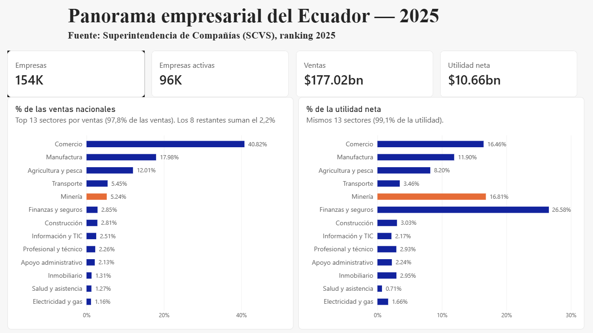
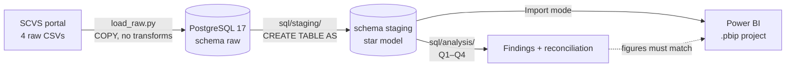
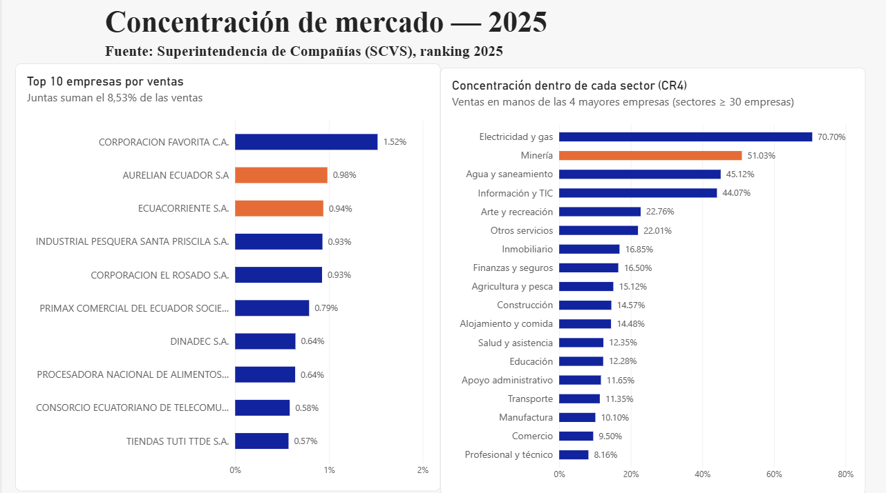
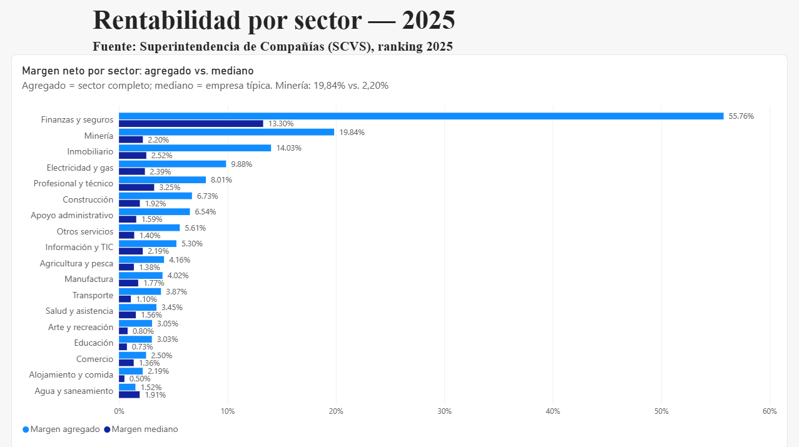
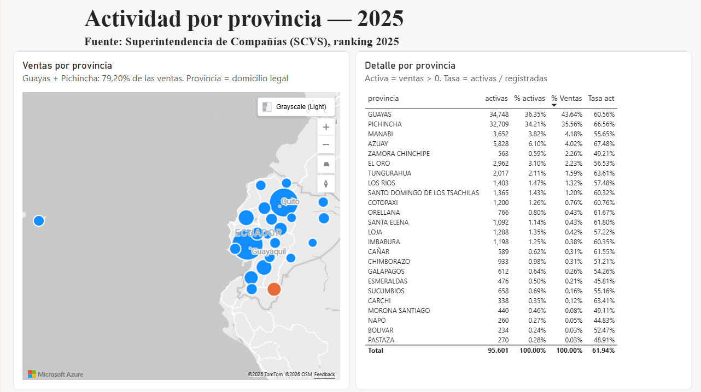

# Ecuador's Business Landscape 2025 — SQL + Power BI

**English** | [Español](README.es.md)

End-to-end analysis of the financial statements of **154,343 Ecuadorian companies** (fiscal year 2025), using the public data of the Superintendencia de Compañías, Valores y Seguros (SCVS). Raw CSVs are loaded into PostgreSQL, cleaned with SQL, analyzed in four business questions and presented in a 4-page Power BI dashboard, with every figure reconciled against the SQL results.



---

## Business questions

| # | Question | Main answer |
|---|---|---|
| Q1 | Which sectors concentrate revenue and profit? | Trade has **40.82%** of revenue, but Finance and Mining capture **43.4%** of net profit with only ~8% of revenue. |
| Q2 | How concentrated is the market? | Nationally it is not (top-10 = **8.53%** of revenue), but within sectors it is: Electricity & gas CR4 = **70.70%**, Mining **51.03%**. |
| Q3 | Which sectors are most profitable? | It depends on the metric: the aggregate margin exceeds the median margin in **17 of 18** sectors. Mining: **19.84%** vs **2.20%**. |
| Q4 | Where is business activity located? | Guayas + Pichincha hold **70.56%** of active companies and **79.20%** of revenue. Zamora Chinchipe ranks 5th in revenue thanks to two mining companies. |

**Common thread: mining.** It shows up in every question: 2 of the 3 largest companies in the country, the second most concentrated sector, the largest gap between large and typical firms, and the reason a small Amazonian province ranks 5th in revenue.

---

## Architecture



- **ELT approach:** Python only loads the raw CSVs into Postgres; every transformation is done in SQL.
- **Raw layer (`raw`):** 4 tables loaded exactly as they come (everything as `text`), with row-count checks against each CSV.
- **Staging layer (`staging`):** typed and cleaned tables forming a star model:
  - `ranking_2025` (fact, 1 row per company)
  - `compania` (company name, province)
  - `ciiu_seccion` (21 sectors with short labels)
  - `segmento` (company size)
- **Analysis layer (`sql/analysis/`):** one file per question, with reconciliation checks and join-integrity checks.
- **Dashboard:** Power BI connected to `staging` (star schema, 3 one-directional `*:1` relationships, 11 DAX measures), saved as a **Power BI Project (`.pbip`)** so the model and the DAX can be read as text in this repo.

### Stack

PostgreSQL 17 (Docker on WSL2) · Python 3 (`psycopg` 3, `python-dotenv`) · SQL · Power BI Desktop (`.pbip` / TMDL) · Git · `ruff`

---

## Dashboard

| Page | Question | Content |
|---|---|---|
| 1. Overview | Q1 | 4 KPIs + share of revenue vs share of profit by sector |
| 2. Concentration | Q2 | National top-10 + CR4 by sector |
| 3. Profitability | Q3 | Aggregate vs median net margin by sector |
| 4. Territory | Q4 | Revenue map + table by province |

Mining is highlighted in **orange** on every page.

<details>
<summary>View pages 2–4</summary>





</details>

---

## Findings

### Q1 — Revenue and profit do not follow each other
- Trade has **40.82%** of revenue; the top 3 sectors (Trade, Manufacturing, Agriculture & fishing) add up to **~70.8%**.
- Finance (**2.85%** of revenue) and Mining (**5.24%**) together capture **~43.4%** of net profit.

### Q2 — A non-concentrated country with concentrated sectors
- The 10 largest companies account for only **8.53%** of national revenue. The largest one, Corporación Favorita, has **1.52%**.
- Concentration lives inside sectors (CR4 = revenue share of the 4 largest companies in the sector, sectors with ≥ 30 active companies):
  - Electricity & gas: **70.70%**
  - Mining: **51.03%**
  - Water & sanitation: **45.12%**
  - ICT: **44.07%**
- **Paradox:** Trade places 5 companies in the national top-10, yet it has one of the lowest CR4 values (**9.50%**). It is a huge and fragmented sector.

### Q3 — Large companies earn more than the typical one
- Only **95,601 of 154,343** companies (**61.94%**) reported revenue > 0.
- The aggregate margin (total sector profit ÷ total sector revenue) exceeds the median margin (typical company) in **17 of 18** sectors.
- Mining: **19.84%** aggregate vs **2.20%** median (~9x).
- Finance leads on both metrics (**55.76% / 13.30%**). The aggregate is likely inflated by holding companies, which V1 does not identify.
- Outside Finance, median margins range from **0.50% to 3.25%**.
- Water & sanitation is the only sector where the median beats the aggregate.

### Q4 — Activity is concentrated in two provinces
- Guayas + Pichincha hold **70.56%** of active companies and **79.20%** of revenue.
- Zamora Chinchipe ranks **5th** in revenue (**2.26%**) with only **0.59%** of active companies. Aurelian (43.55%) and Ecuacorriente (41.62%) generate **85.17%** of its revenue.
- The activity rate (active ÷ registered) ranges from **44.83%** (Napo) to **67.48%** (Azuay). The Amazon provinces and Esmeraldas have the lowest rates.

---

## Recommendations

1. **Report profitability with two metrics.** The aggregate margin describes the sector; the median describes the typical company. Using only the aggregate overstates the profitability most firms actually get (Mining: 19.84% vs 2.20%).
2. **Measure concentration by sector or sub-sector, never nationally.** The national top-10 suggests a competitive economy, while 4 sectors have CR4 > 44%. To make claims about a specific market (e.g. supermarkets), drill down to `ciiu_n6`: CIIU section G is too broad.
3. **Do not read the territorial map as the location of operations.** The province is the company's legal domicile. Regional analysis should cross this data with information about where companies actually operate.
4. **Treat company counts with care.** 38% of companies in the ranking report no revenue. Before using these counts as "active companies", filter by revenue or by financial-statement status.

**Hypotheses not tested in V1** (presented as hypotheses, not conclusions): the margin gap in Mining and Electricity is consistent with capital-intensive sectors; regulated tariffs might explain the Water & sanitation exception; Zamora's revenue reflects its domiciled mining chain.

---

## Validation

Every dashboard figure was reconciled against the SQL queries in `sql/analysis/`:

| Check | SQL | Power BI |
|---|---|---|
| Companies 2025 | 154,343 | 154,343 ✓ |
| Active companies (revenue > 0) | 95,601 | 95,601 ✓ |
| Total revenue | USD 177,020,766,391 | USD 177.02 bn ✓ |
| Total net profit | USD 10,662,129,196.51 | USD 10,662,129,196.51 ✓ |
| Trade, share of revenue | 40.82% | 40.82% ✓ |
| National top-10 | 8.53% | 8.53% ✓ |
| CR4 Electricity & gas / Mining | 70.70% / 51.03% | ✓ |
| Mining margin, aggregate / median | 19.84% / 2.20% | ✓ |
| Guayas + Pichincha (active / revenue) | 70.56% / 79.20% | ✓ |

Every layer is also validated at build time:
- `load_raw.py` checks row counts against each CSV.
- Each staging script ends in a `DO` block that aborts the transaction if counts, nulls, orphan keys or content checks fail.
- Each staging script was tested with a normal run, a second run (idempotency) and a forced failure with rollback.

---

## Key data decisions

- **Year 2025** (most recent; no signs of truncation). Grain: 1 row per company (`expediente`).
- **Revenue = `ingresos_ventas`** (operating revenue), not `ingresos_totales`.
- **Active company = `ingresos_ventas > 0`.**
- **Minimum threshold of 30 active companies** for sector-level conclusions (Q2 and Q3). It excludes sectors that are too small (O, T, U), where CR4 or margins reach ~100%.
- **CR4** as the concentration measure (industry standard).
- **Margin = aggregate + median**, never the average of the ratio (too sensitive to outliers).
- **`n_empleados` > 100,000 → NULL**: 2 values were national ID numbers entered by mistake in the source. The rows are kept.
- **Text cleaning:** `TRIM` on every padded key and attribute (the source uses fixed-width fields). The `Z = DEPURAR` (CIIU) and `0 = NO DEFINIDO` (size) sentinel values are removed.
- Keys are stored as `text` to preserve leading zeros (e.g. province codes `'01'`–`'24'`).
- No foreign keys between fact and dimensions, to keep each staging script independently re-runnable. Orphan keys are checked with anti-joins instead.

---

## Limitations

- **Province = legal domicile**, not the place of operation.
- **Revenue ≠ GDP:** sales are counted at every link of the supply chain. Total revenue (~USD 177 billion) is not comparable with GDP.
- **Holding companies** are not identified, so the Finance aggregate margin is likely inflated.
- **CIIU section G (Trade)** mixes supermarkets, car dealers, wholesalers, etc. Concentration in specific markets cannot be concluded at this level.
- **Frozen snapshot** of the SCVS data downloaded on **Oct 11, 2026**. The portal updates daily, so figures may differ from later publications or press reports.
- Source issues kept as-is and documented: 2 implausible revenue-per-employee cases; 2 companies with no sector or no size; typos in some CIIU descriptions.
- Single year (2025): no time trends in V1.

---

## Repository structure

```
.
├── scripts/
│   └── load_raw.py              # Loads the 4 CSVs into the raw schema (COPY + row-count check)
├── sql/
│   ├── profiling/               # Raw data profiling (fact and dimensions)
│   ├── staging/                 # 01_segmento, 02_ciiu_seccion, 03_compania, 04_ranking_2025
│   └── analysis/                # 01_sector_concentration … 04_province_activity (Q1–Q4)
├── powerbi/                     # Power BI Project (.pbip): report + semantic model in TMDL
├── assets/                      # Dashboard screenshots
├── data/raw/                    # SCVS CSVs (not versioned)
├── docker-compose.yml
├── requirements.txt
└── README.md / README.es.md
```

Code and comments are in English; SCVS source column names are kept in Spanish.

---

## How to reproduce

**Requirements:** Docker, Python 3, Power BI Desktop (Windows) for the dashboard.

1. **Clone the repo** and create your `.env` from the template:
   ```bash
   cp .env.example .env
   ```

2. **Download the data** from the [SCVS company ranking portal](https://appscvsmovil.supercias.gob.ec/ranking/reporte.html) and place the 4 CSVs in `data/raw/`: `bi_ranking.csv`, `bi_compania.csv`, `bi_ciiu.csv`, `bi_segmento.csv`. The portal updates daily; this project uses the snapshot downloaded on Oct 11, 2026.

3. **Start Postgres and load the raw layer:**
   ```bash
   docker compose up -d
   pip install -r requirements.txt
   python scripts/load_raw.py
   ```

4. **Build the staging layer** (in order):
   ```bash
   for f in sql/staging/0*.sql; do
     docker compose exec -T db psql -U scvs -d scvs -v ON_ERROR_STOP=1 < "$f"
   done
   ```

5. **Run the analysis** (optional): the files in `sql/analysis/` work the same way.

6. **Open the dashboard:** open `powerbi/scvs_dashboard.pbip` in Power BI Desktop and click **Refresh** (it connects to `localhost:5432`). The repo does not include data, so you must run steps 1–4 first.

### Versions

| Tag | Milestone |
|---|---|
| `v0.1` | Raw layer |
| `v0.2` | Staging layer |
| `v0.3` | SQL analysis (Q1–Q4) |
| `v0.4` | Power BI dashboard |
| `v1.0` | Documentation and release |

